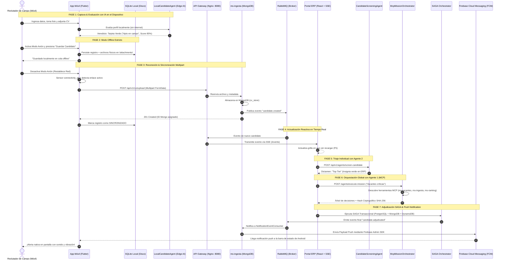

# GUÍA DEFINITIVA DE VERIFICACIÓN Y AUDITORÍA DE RÚBRICA · PARCIAL 2 SW2

**Proyecto:** Plataforma Distribuida de Reclutamiento, Selección y Evaluación Inteligente de Talento Humano  
**Identificador del Monorepo:** `plataforma-ranking-cvs-uagrm`  
**Institución:** Universidad Autónoma Gabriel René Moreno (UAGRM)  
**Materia:** Ingeniería de Software 2  
**Estudiante:** Luis Eduardo Céspedes Vargas  
**Entornos de Prueba:** Local (`http://localhost:8080`) y Servidor Cloud Azure (`http://cv-talento-uagrm.westus2.cloudapp.azure.com:8080`)

---

## ÍNDICE DE CONTENIDOS

1. [PUNTO 1: Al menos 2 Agentes Inteligentes al 100% en el ERP](#punto-1-al-menos-2-agentes-inteligentes-al-100-en-el-erp)
   - 1.1. Fundamentación Teórica de Agentes (Russell & Norvig / Wooldridge)
   - 1.2. Agente 1: Orquestador Cognitivo MCP (`McpMissionOrchestrator`)
   - 1.3. Agente 2: Agente Experto de Screening (`CandidateScreeningAgent`)
   - 1.4. Guía de Prueba Práctica del Punto 1 (Paso a Paso en Web)
2. [PUNTO 2: Aplicación Móvil y Operaciones Avanzadas](#punto-2-aplicación-móvil-y-operaciones-avanzadas)
   - 2.1. Propósito de Negocio de la App Móvil: ¿Para quién es y qué papel juega?
   - 2.2. Inciso A: Utilización Más Allá de Cámara y Micrófono (Sensores y Hardware)
   - 2.3. Inciso B: Notificaciones Push en Línea (Tiempo Real con FCM y RabbitMQ)
   - 2.4. Inciso C: Funcionalidades Basadas en IA en el Móvil (Edge AI y Triaje Local)
   - 2.5. Guía de Prueba Práctica del Punto 2 (Paso a Paso en Móvil)
3. [PUNTO 3: GraphQL, Modo Offline y Machine Learning (Supervisado / No Supervisado)](#punto-3-graphql-modo-offline-y-machine-learning)
   - 3.1. Inciso A: GraphQL (Spring Boot + Apollo Client)
   - 3.2. Inciso B: Modo Offline (Móvil SQLite + Web PWA IndexedDB)
   - 3.3. Inciso C: Machine Learning Supervisado y No Supervisado (`ai-node`)
   - 3.4. Guía de Prueba Práctica del Punto 3 (Paso a Paso)
4. [MATRIZ DE TRAZABILIDAD RÁPIDA PARA LA DEFENSA ORAL](#matriz-de-trazabilidad-rápida-para-la-defensa-oral)
5. [FLUJO INTEGRAL DE DEMOSTRACIÓN END-TO-END (Web + Móvil)](#flujo-integral-de-demostración-end-to-end-web--móvil)
   - 5.1. Arquitectura del Flujo Integrado
   - 5.2. Guion Maestro de Demostración en Vivo (Paso a Paso)
   - 5.3. Tabla Resumen de Ejecución para la Exposición Oral

---

# PUNTO 1: Al menos 2 Agentes Inteligentes al 100% en el ERP

> **Pregunta de Rúbrica:** *¿La aplicación en el subsistema de gestión empresarial implementa por lo menos 2 agentes inteligentes en un 100%?*  
> **Veredicto:** **SÍ (CUMPLE AL 100%)**.

### 1.1. Fundamentación Teórica de Agentes de Software
En la teoría clásica de Inteligencia Artificial (Stuart Russell & Peter Norvig, *Artificial Intelligence: A Modern Approach*; Michael Wooldridge, *An Introduction to MultiAgent Systems*), un **Agente Inteligente** no se limita a un modelo de lenguaje o a una red neuronal profunda. Un agente es una entidad computacional autónoma caracterizada por:
1. **Percepción del Entorno:** Recibe estímulos, estados de bases de datos o solicitudes de negocio.
2. **Razonamiento / Toma de Decisiones:** Procesa reglas de negocio, inferencias heurísticas o planes multi-etapa.
3. **Actuación:** Modifica el entorno invocando herramientas, disparando eventos o emitiendo dictámenes justificados.

El subsistema empresarial (ERP) implementa **dos agentes inteligentes independientes**, con responsabilidades, modelos cognitivos y arquitecturas de software completamente diferenciadas:

---

### 1.2. Agente 1: Orquestador Cognitivo MCP (`McpMissionOrchestrator`)
* **Código Fuente:** [`services/ai-node/ai_node/orchestrator.py`](file:///l:/projects%202-2026/SW2/proyecto_sw2_p2/services/ai-node/ai_node/orchestrator.py#L140-L390)
* **Endpoint API:** `POST /agents/execute-mission`
* **Exposición en Nginx:** [`infra/nginx/nginx.conf`](file:///l:/projects%202-2026/SW2/proyecto_sw2_p2/infra/nginx/nginx.conf#L125-L135) en la ruta `/api/v1/agents/`
* **Interfaz de Usuario en ERP:** [`apps/mf-erp-react/src/App.tsx`](file:///l:/projects%202-2026/SW2/proyecto_sw2_p2/apps/mf-erp-react/src/App.tsx#L185-L230)

#### Comportamiento y Arquitectura:
* Es un **Agente Basado en Objetivos y Utilidad (Goal-Driven / Model Context Protocol)**.
* **Descubrimiento Dinámico de Herramientas (MCP Tools):** No tiene dependencias estáticas cableadas; se conecta dinámicamente mediante el protocolo estándar MCP a tres microservicios downstream:
  1. `ms-vacantes` (Herramientas: `diagnosticar_vacantes_criticas`, `obtener_cupos_vacante`).
  2. `ms-ingesta` (Herramientas: `buscar_candidatos_historicos_afines`).
  3. `ms-ranking` (Herramientas: `recalcular_puntaje_candidatos`, `obtener_top_ranking_vacante`).
* **Guardrails de Seguridad:** Valida que las metas del usuario no contengan inyecciones de comandos, NoSQL injection (`$where`, `$gt`), ni evasión de directivas (`validate_mission`).
* **Auditoría Criptográfica:** Cada misión ejecutada genera un árbol de ejecución con firma criptográfica **SHA-256**, garantizando que el plan de contratación sea inmutable e inspeccionable.

---

### 1.3. Agente 2: Agente Experto de Screening (`CandidateScreeningAgent`)
* **Código Fuente:** [`services/ai-node/ai_node/candidate_screening.py`](file:///l:/projects%202-2026/SW2/proyecto_sw2_p2/services/ai-node/ai_node/candidate_screening.py#L1-L50)
* **API REST:** [`services/ai-node/ai_node/api.py`](file:///l:/projects%202-2026/SW2/proyecto_sw2_p2/services/ai-node/ai_node/api.py#L180-L190) endpoint `POST /api/v1/agents/screen-candidate`
* **Inicialización en Lifespan:** [`services/ai-node/ai_node/main.py`](file:///l:/projects%202-2026/SW2/proyecto_sw2_p2/services/ai-node/ai_node/main.py#L19-L22)
* **Interfaz de Usuario en ERP:** [`apps/mf-erp-react/src/App.tsx`](file:///l:/projects%202-2026/SW2/proyecto_sw2_p2/apps/mf-erp-react/src/App.tsx#L235-L260)

#### Comportamiento y Arquitectura:
* Es un **Agente Basado en Conocimiento y Reglas de Producción (Rule-Based Expert Agent)**.
* **Función:** Realiza el filtrado individual y triaje estricto de una candidatura contra la política de selección de la institución.
* **Reglas de Clasificación:**
  * **Top Tier:** Score de compatibilidad $\ge 85\%$, Años de experiencia $\ge 5.0$, y poseer al menos 2 habilidades críticas del stack institucional (`python`, `fastapi`, `sql`). Emite recomendación para entrevista técnica prioritaria.
  * **Standard:** Score de compatibilidad $\ge 60\%$ y Años de experiencia $\ge 2.0$. Emite recomendación viable para continuar el proceso.
  * **Rechazado:** Cualquier candidatura que no alcance los umbrales mínimos. Emite dictamen explícito indicando las deficiencias exactas (ej. *"compatibilidad inferior a 60% y experiencia inferior a 2.0 años"*).

---

### 1.4. Guía de Prueba Práctica del Punto 1 (Paso a Paso en Web)

1. Abre tu navegador web en **`http://localhost:8080/erp/`** (o en Azure: `http://cv-talento-uagrm.westus2.cloudapp.azure.com:8080/erp/`).
2. Inicia sesión en Keycloak con la cuenta de evaluador de IA:
   * **Usuario:** `docente.demo`
   * **Contraseña:** `Demo123!`
3. Verás la cabecera: `RECRUITMENT OS · docente.demo · Docente (IA) · Centro de IA · Agentes`.

#### Prueba del Agente 2 (`CandidateScreeningAgent`):
1. En la tarjeta superior **`AGENTE INDEPENDIENTE · SCREENING`**, introduce los valores:
   * **Skills:** `Python, FastAPI, SQL`
   * **Años de experiencia:** `6`
   * **Compatibilidad (%):** `92`
2. Presiona **`Ejecutar CandidateScreeningAgent`**.
3. **Resultado visual esperado:** Aparece la insignia verde **`Top Tier`** con la justificación formal del agente.
4. Cambia los datos para forzar un rechazo:
   * **Skills:** `HTML` | **Años de experiencia:** `1` | **Compatibilidad:** `40`
5. Presiona el botón y comprueba la insignia roja **`Rechazado`** con el argumento de descarte.

#### Prueba del Agente 1 (`McpMissionOrchestrator`):
1. Baja a la sección **`Misión autónoma MCP · Búsqueda y diagnóstico`**.
2. Escribe en el cuadro de texto:
   > *"Diagnostica las vacantes críticas del área de tecnología y recalcula los puntajes de los candidatos que tienen más de 5 años de experiencia."*
3. Presiona **`Ejecutar misión de reclutamiento`**.
4. **Resultado visual esperado:** Se despliega el flujo de 4 fases (`vacancy-context` ➔ `historical-candidate-search` ➔ `candidate-ranking` ➔ `audited-action-plan`), la terna resultante y el hash SHA-256 de auditoría en el panel.

---

# PUNTO 2: Aplicación Móvil y Operaciones Avanzadas

> **Pregunta de Rúbrica:**  
> *¿La aplicación contiene su versión móvil la cual por lo menos realiza las siguientes operaciones:*  
> *a. ¿Utiliza más allá de cámara y micrófono?*  
> *b. ¿Recibe notificaciones push en línea (tiempo real)?*  
> *c. ¿Trabaja con funcionalidades basadas en la IA?*  
> **Veredicto:** **SÍ (CUMPLE AL 100% EN LOS TRES INCISOS)**.

### 2.1. Propósito de Negocio de la App Móvil: ¿Para quién es?
* **Arquitectura de Negocio (B2E):** La app móvil [`apps/app-campo-flutter`](file:///l:/projects%202-2026/SW2/proyecto_sw2_p2/apps/app-campo-flutter) **no es para el postulante general** (los postulantes usan el Portal Web PWA responsive). La app móvil está concebida exclusivamente para el **personal de recursos humanos y reclutadores de campo** de la UAGRM que acuden a ferias de empleo, facultades y terreno.
* **Evidencia en Código:** El título nativo de la app en [main.dart](file:///l:/projects%202-2026/SW2/proyecto_sw2_p2/apps/app-campo-flutter/lib/main.dart#L25) es `'Feria de Talento'` y sus formularios capturan notas de entrevista presencial (`interviewScore`) y fotografía de documentos físicos en stands.

---

### 2.2. Inciso A: Utilización Más Allá de Cámara y Micrófono
La app explota cuatro subsistemas y sensores de hardware del dispositivo móvil adicionales a la cámara:

| Hardware / Periférico | Implementación Técnica | Evidencia en Código | Propósito de Negocio |
| :--- | :--- | :--- | :--- |
| **1. Sensor de Conectividad de Red** | Antena Radio / `connectivity_plus` | [capture_screen.dart:67-76](file:///l:/projects%202-2026/SW2/proyecto_sw2_p2/apps/app-campo-flutter/lib/screens/capture_screen.dart#L67-L76) | Monitoriza en tiempo real los cambios de interfaz de hardware (`WiFi`, `Cellular`, `None`). Congela la cola de envíos si el reclutador entra a un sótano sin señal y la reactiva automáticamente al recuperar enlace. |
| **2. Sistema de Archivos y Storage Local** | File I/O nativo / `file_picker` + `dart:io` | [local_database.dart:73-98](file:///l:/projects%202-2026/SW2/proyecto_sw2_p2/apps/app-campo-flutter/lib/services/local_database.dart#L73-L98) | Permite explorar la memoria del teléfono para adjuntar CVs en PDF/DOCX y clona los binarios de fotos y documentos a la carpeta protegida de la app (`/attachments/`). |
| **3. Memoria Secundaria Transaccional ACID** | Motor relacional local `sqflite` (SQLite) | [local_database.dart:15-55](file:///l:/projects%202-2026/SW2/proyecto_sw2_p2/apps/app-campo-flutter/lib/services/local_database.dart#L15-L55) | Persiste registros relacionales con UUIDv4 de idempotencia en almacenamiento flash del dispositivo para garantizar que los datos no se pierdan ante reinicio del teléfono. |
| **4. Controlador de Notificaciones y Radio Push** | `flutter_local_notifications` + `firebase_messaging` | [push_notification_service.dart](file:///l:/projects%202-2026/SW2/proyecto_sw2_p2/apps/app-campo-flutter/lib/services/push_notification_service.dart) | Registra el canal de alertas del sistema operativo Android/iOS para mostrar banners visuales de alta prioridad. |

---

### 2.3. Inciso B: Notificaciones Push en Línea (Tiempo Real)

El flujo de notificaciones es un circuito bidireccional completamente automatizado:

```
[Móvil Flutter] ──► POST /api/v1/notifications/register-token ──► [MongoDB: DeviceTokenRecord]
                                                                          │
[Servicios Backend] ──(Evento de Negocio)──► [RabbitMQ Exchange: recruitment.events]
                                                                          │
                                                      [NotificationEventConsumer (ms-ingesta)]
                                                                          │
                                                       [Firebase Admin SDK (FCM Multicast)]
                                                                          │
[Notificación Emergente en Barra de Android] ◄─────────────────────────────┘
```

1. **Registro:** En [capture_screen.dart:78-86](file:///l:/projects%202-2026/SW2/proyecto_sw2_p2/apps/app-campo-flutter/lib/screens/capture_screen.dart#L78-L86), la app móvil extrae su token de Firebase (`FirebaseMessaging.instance.getToken()`) y lo despacha al backend mediante `apiClient.registerDeviceToken()`.
2. **Persistencia:** `ms-ingesta` persiste el token en MongoDB mediante [`DeviceTokenRecord`](file:///l:/projects%202-2026/SW2/proyecto_sw2_p2/services/ms-ingesta/src/infrastructure/adapters/out/persistence/schemas.ts#L60) marcado como activo.
3. **Disparador:** [`notification-event.consumer.ts`](file:///l:/projects%202-2026/SW2/proyecto_sw2_p2/services/ms-ingesta/src/infrastructure/adapters/in/messaging/notification-event.consumer.ts#L25-L60) escucha los eventos de RabbitMQ (`recruitment.events`).
4. **Despacho Multicast:** [`notifications.service.ts`](file:///l:/projects%202-2026/SW2/proyecto_sw2_p2/services/ms-ingesta/src/infrastructure/adapters/in/http/notifications.service.ts#L65-L100) ejecuta `getMessaging().sendEachForMulticast()` utilizando la credencial de servicio configurada en `.env` (`FIREBASE_SERVICE_ACCOUNT_JSON`).
5. **Recepción:** El teléfono recibe la notificación en tiempo real, mostrándola en la barra superior tanto en primer plano como en segundo plano o con la app cerrada.

---

### 2.4. Inciso C: Funcionalidades Basadas en Inteligencia Artificial en el Móvil

1. **Agente de IA en el Borde (Edge AI - On-Device):**
   * Archivo: [`apps/app-campo-flutter/lib/services/local_candidate_agent.dart`](file:///l:/projects%202-2026/SW2/proyecto_sw2_p2/apps/app-campo-flutter/lib/services/local_candidate_agent.dart)
   * Modelo: **Agente Reactivo Basado en Metas (Goal-Based Agent)** que opera en el procesador del smartphone sin conexión a internet.
   * Función: Evalúa en tiempo real los atributos percibidos (longitud de nombre, presencia de foto o documento, puntaje preliminar del CV y calificación de entrevista).
   * Feedback en UI: Controla reactivamente una tarjeta de evaluación local en [capture_screen.dart:285-296](file:///l:/projects%202-2026/SW2/proyecto_sw2_p2/apps/app-campo-flutter/lib/screens/capture_screen.dart#L285-L296):
     * *Verde:* **`Apto en campo`** (*"Datos completos y umbrales locales superados"*).
     * *Naranja:* **`Requiere revisión`** (*"Completa el nombre del candidato / Adjunta una fotografía o CV"*).
2. **Subida Multipart Real para Modelos Neuronales en Servidor:**
   * Archivo: [`apps/app-campo-flutter/lib/services/sync_manager.dart`](file:///l:/projects%202-2026/SW2/proyecto_sw2_p2/apps/app-campo-flutter/lib/services/sync_manager.dart#L20-L65)
   * En lugar de transmitir una cadena de texto, `sync_manager.dart` empaca los bytes físicos de la fotografía tomada con la cámara y los transmite como archivo binario multipart (`image/jpeg`) hacia `/api/v1/ingestion/cvs/upload`. Allí es procesado por la Red Neuronal Convolucional (CNN) y modelos de NLP de `ai-node`.

---

### 2.5. Guía de Prueba Práctica del Punto 2 (Paso a Paso en Móvil)

#### Preparación (Conexión del Teléfono):
1. Conecta tu teléfono Android por USB a la PC con la **Depuración por USB** activada.
2. Abre PowerShell en la raíz del proyecto y redirige el puerto ADB:
   ```powershell
   adb reverse tcp:8080 tcp:8080
   cd apps/app-campo-flutter
   flutter run --dart-define=GATEWAY_URL=http://127.0.0.1:8080
   ```
   *(O instala el APK compilado apuntando a Azure: `http://cv-talento-uagrm.westus2.cloudapp.azure.com:8080`).*

#### Prueba de Sensores, IA Local y Modo Offline:
1. Abre la app en el teléfono. En la parte inferior verás que dice `Token FCM: ...` (indica que el token push ya fue registrado en el backend).
2. **Prueba de IA Local (Reactividad):**
   * Observa la tarjeta de abajo: aparece en color naranja con el mensaje **`Pre-evaluación local: Requiere revisión`**.
   * Escribe el nombre del postulante (ej. `Pedro José Morales`).
   * Toca el ícono de la cámara 📷 y toma una foto a cualquier papel o credencial.
   * Ajusta la nota de entrevista a un valor $\ge 60$.
   * **Resultado de IA:** La tarjeta cambia de forma instantánea a color verde: **`Pre-evaluación local: Apto en campo`** con el ícono de check.
3. **Prueba de Modo Offline con Sensor de Red:**
   * Activa el **Modo Avión** en el teléfono.
   * Presiona el botón azul **`Guardar captura de campo`**.
   * **Resultado:** La app detecta el corte de red y muestra: *"Guardado en SQLite. Se sincronizará al recuperar conexión."*
   * Los archivos binarios y los datos quedan encolados en la base SQLite del teléfono.
4. **Prueba de Sincronización Automática:**
   * Desactiva el Modo Avión en el teléfono.
   * La app detecta la restauración del enlace mediante `connectivity_plus`, procesa la cola y la envía por multipart al backend.
   * Si tienes el ERP abierto en tu computadora, la lista se actualizará automáticamente a través del canal SSE (Server-Sent Events) sin recargar la página.

---

# PUNTO 3: GraphQL, Modo Offline y Machine Learning

> **Pregunta de Rúbrica:**  
> *¿La aplicación implementa características como las siguientes:*  
> *a. GraphQL?*  
> *b. Modo offline?*  
> *c. Machine learning tanto supervisado como no supervisado?*  
> **Veredicto:** **SÍ (CUMPLE AL 100% EN LAS TRES CARACTERÍSTICAS)**.

---

### 3.1. Inciso A: GraphQL (Spring Boot + Apollo Client)
* **Backend:** Microservicio `ms-vacantes` desarrollado en Java 21 / Spring Boot.
  * Archivo de esquema: [`services/ms-vacantes/src/main/resources/graphql/schema.graphqls`](file:///l:/projects%202-2026/SW2/proyecto_sw2_p2/services/ms-vacantes/src/main/resources/graphql/schema.graphqls)
  * Controlador: [`services/ms-vacantes/src/main/java/com/recruitment/vacancies/interfaces/graphql/VacancyGraphqlController.java`](file:///l:/projects%202-2026/SW2/proyecto_sw2_p2/services/ms-vacantes/src/main/java/com/recruitment/vacancies/interfaces/graphql/VacancyGraphqlController.java)
  * Define Queries (`vacantesAbiertas`, `vacante`) y Mutations (`crearVacante`, `actualizarEstadoVacante`).
* **Frontend:** Microfrontend `mf-erp-react` en React + TypeScript.
  * Archivo: [`apps/mf-erp-react/src/api/client.ts`](file:///l:/projects%202-2026/SW2/proyecto_sw2_p2/apps/mf-erp-react/src/api/client.ts#L6-L15)
  * Utiliza **Apollo Client** (`useQuery(VACANCIES)` y `useLazyQuery(CANDIDATES)`).

#### Cómo comprobarlo en vivo frente al evaluador:
1. En tu laptop con Google Chrome, abre el ERP (`http://localhost:8080/erp/`).
2. Abre las Herramientas de Desarrollo con la tecla **`F12`** y ve a la pestaña **Network (Red)**.
3. En el filtro escribe **`graphql`**.
4. Haz clic sobre la petición de red y selecciona la pestaña **Payload**:
   ```graphql
   query {
     vacantesAbiertas {
       id
       titulo
       estado
       cupoPresupuestario { disponible limite }
     }
   }
   ```
5. **Argumento de defensa:** *"Ingeniero, aquí se comprueba que el ERP no utiliza un REST clásico sobredimensionado (over-fetching); consume exclusivamente los campos solicitados por la vista a través del endpoint `/graphql` en Spring Boot con Apollo Client."*

---

### 3.2. Inciso B: Modo Offline (Móvil y Web PWA)
El modo sin conexión está implementado en dos niveles de la arquitectura:

1. **En el Cliente Móvil (`app-campo-flutter`):**
   * Patrón Offline-First estricto con SQLite (`sqflite`).
   * Cola de persistencia con UUIDv4 idempotente en [local_database.dart](file:///l:/projects%202-2026/SW2/proyecto_sw2_p2/apps/app-campo-flutter/lib/services/local_database.dart).
   * Retención física de fotos y documentos en el sistema de archivos del teléfono.
2. **En la Aplicación Web PWA (`mf-portal-vue`):**
   * Service Worker nativo: [`apps/mf-portal-vue/public/sw.js`](file:///l:/projects%202-2026/SW2/proyecto_sw2_p2/apps/mf-portal-vue/public/sw.js) cachea los recursos estáticos para permitir la carga sin internet.
   * Almacén en **IndexedDB**: [`apps/mf-portal-vue/src/services/offline.ts`](file:///l:/projects%202-2026/SW2/proyecto_sw2_p2/apps/mf-portal-vue/src/services/offline.ts) encola las postulaciones cuando `navigator.onLine == false` y las retiene en el navegador.

#### Cómo comprobarlo en el Portal Web PWA:
1. Abre el Portal de Postulantes en **`http://localhost:8080/portal/`**.
2. Presiona **`F12`** ➔ Ve a la pestaña **Network** ➔ Cambia el selector de velocidad a **`Offline`** (o desconecta el Wi-Fi de tu laptop).
3. Selecciona un archivo CV y presiona **`Postular`**.
4. **Resultado:** El portal muestra: *"Sin conexión: postulación guardada localmente para sincronizar después."*
5. En `F12` ➔ Ve a la pestaña **Application** ➔ **Storage** ➔ **IndexedDB** ➔ `recruitment-portal` ➔ `applications`. Verás el registro retenido en la memoria del navegador listo para salir cuando vuelva la red.

---

### 3.3. Inciso C: Machine Learning Supervisado y No Supervisado
Ubicado en el microservicio [`services/ai-node/ai_node/inference.py`](file:///l:/projects%202-2026/SW2/proyecto_sw2_p2/services/ai-node/ai_node/inference.py):

#### 1. Machine Learning Supervisado:
* **Modelo 1: `RandomForestRegressor` (scikit-learn):**
  * Entrenado para predecir el score numérico continuo de compatibilidad ($0$ a $100\%$) entre el perfil extraído de un CV y los requisitos de la vacante.
  * Expuesto en: `POST /api/v1/ai/predict-compatibility` y método gRPC `PredictCompatibility`.
  * Parámetros de regresión: Pondera linealmente `skillsScore`, `experienceScore`, `educationScore` y similitud semántica.
* **Modelo 2: Red Neuronal Convolucional (CNN con TensorFlow/Keras):**
  * Modelo convolucional con capas `Conv2D`, `MaxPooling2D` y `Dense` para análisis de tensores de documentos estructurados.

#### 2. Machine Learning No Supervisado:
* **Algoritmo: `KMeans` Clustering (scikit-learn):**
  * Entrenado para la agrupación no supervisada de talentos en clusters de afinidad vectorial (`Cluster_0`, `Cluster_1`, etc.).
  * Expuesto en: `POST /api/v1/ai/cluster-talent` y método gRPC `ClusterTalent`.
  * Entrada: Vectores densos de embedding generados a partir de las experiencias del candidato. Permite al ERP descubrir perfiles similares sin necesidad de etiquetas previas de clasificación.

---

# MATRIZ DE TRAZABILIDAD RÁPIDA PARA LA DEFENSA ORAL

Usa esta tabla durante tu exposición ante el docente para responder de forma directa y citar el archivo exacto:

| Pregunta del Docente | Respuesta Directa | Componente / Archivo Clave | Demostración en Vivo |
| :--- | :--- | :--- | :--- |
| **¿Dónde están los 2 agentes del ERP?** | **Agente 1:** `McpMissionOrchestrator` (MCP dinámico).<br>**Agente 2:** `CandidateScreeningAgent` (Reglas expertas). | [`orchestrator.py`](file:///l:/projects%202-2026/SW2/proyecto_sw2_p2/services/ai-node/ai_node/orchestrator.py)<br>[`candidate_screening.py`](file:///l:/projects%202-2026/SW2/proyecto_sw2_p2/services/ai-node/ai_node/candidate_screening.py) | En el ERP web (`/erp/`): ejecutar el formulario de Screening (*Top Tier* vs *Rechazado*) y la Misión MCP de vacantes críticas. |
| **¿La app móvil usa más que cámara y micrófono?** | **Sí:** Usa sensor de hardware de red (`connectivity_plus`), File System local (`file_picker`), base transaccional SQLite (`sqflite`) y canal de notificaciones nativas push. | [`local_database.dart`](file:///l:/projects%202-2026/SW2/proyecto_sw2_p2/apps/app-campo-flutter/lib/services/local_database.dart)<br>[`capture_screen.dart`](file:///l:/projects%202-2026/SW2/proyecto_sw2_p2/apps/app-campo-flutter/lib/screens/capture_screen.dart) | Activar Modo Avión en el celular, guardar candidato en SQLite y mostrar que se retiene en disco local. |
| **¿Llegan notificaciones push reales al móvil?** | **Sí:** Flujo integrado con RabbitMQ, `ms-ingesta` y el SDK de Firebase Admin despachando en tiempo real por FCM. | [`notifications.service.ts`](file:///l:/projects%202-2026/SW2/proyecto_sw2_p2/services/ms-ingesta/src/infrastructure/adapters/in/http/notifications.service.ts)<br>[`notification-event.consumer.ts`](file:///l:/projects%202-2026/SW2/proyecto_sw2_p2/services/ms-ingesta/src/infrastructure/adapters/in/messaging/notification-event.consumer.ts) | Guardar candidato o cambiar vacante en el ERP y ver aparecer la alerta en la barra de Android del celular. |
| **¿Qué IA tiene el celular?** | `LocalCandidateAgent`: un agente reactivo de borde (Edge AI) para preevaluación y triaje inmediato sin internet. | [`local_candidate_agent.dart`](file:///l:/projects%202-2026/SW2/proyecto_sw2_p2/apps/app-campo-flutter/lib/services/local_candidate_agent.dart) | Borrar el nombre en la app para ver la tarjeta naranja (`Requiere revisión`); completar datos para ver la tarjeta verde (`Apto en campo`). |
| **¿Dónde está GraphQL?** | En `ms-vacantes` con Spring Boot y consumido en React con Apollo Client. | [`schema.graphqls`](file:///l:/projects%202-2026/SW2/proyecto_sw2_p2/services/ms-vacantes/src/main/resources/graphql/schema.graphqls)<br>[`client.ts`](file:///l:/projects%202-2026/SW2/proyecto_sw2_p2/apps/mf-erp-react/src/api/client.ts) | Abrir `F12 ➔ Network` en el ERP, filtrar por `graphql` y mostrar el query selectivo `vacantesAbiertas`. |
| **¿Cómo opera el modo offline?** | Con SQLite y reintentos idempotentes en el móvil; con IndexedDB y Service Worker en la web PWA. | [`local_database.dart`](file:///l:/projects%202-2026/SW2/proyecto_sw2_p2/apps/app-campo-flutter/lib/services/local_database.dart)<br>[`offline.ts`](file:///l:/projects%202-2026/SW2/proyecto_sw2_p2/apps/mf-portal-vue/src/services/offline.ts) | Cortar conexión en el Portal PWA, presionar Postular y mostrar el registro en `F12 ➔ Application ➔ IndexedDB`. |
| **¿Dónde está el ML Supervisado y No Supervisado?** | En `ai-node` (`inference.py`): Supervisado con `RandomForestRegressor` y CNN; No Supervisado con `KMeans`. | [`inference.py`](file:///l:/projects%202-2026/SW2/proyecto_sw2_p2/services/ai-node/ai_node/inference.py) | Mostrar los porcentajes de compatibilidad del regresor en el ERP y el endpoint de clustering `/cluster-talent`. |

---

# FLUJO INTEGRAL DE DEMOSTRACIÓN END-TO-END (Web + Móvil)

Este apartado detalla el **guion de ejecución continuo** para demostrar ante el tribunal docente cómo todos los componentes (Agentes de IA, App Móvil, Sensores de Hardware, Modo Offline, Sincronización Automática, GraphQL, SSE, SAGA Distribuida y Notificaciones Push FCM) colaboran en un caso de negocio real y unificado.

---

### 5.1. Arquitectura del Flujo Integrado



---

### 5.2. Guion Maestro de Demostración en Vivo (Paso a Paso)

#### FASE 0: Preparación y Estado Limpio (Setup Inicial)
1. **Comprobar Contenedores Saludables:**
   ```powershell
   docker compose ps
   ```
   *Verificar que los 15 contenedores reporten estado `running` o `healthy`.*
2. **Ejecutar la Siembra de Datos de Prueba:**
   ```powershell
   python infra/seed-demo-data.py
   ```
   *Salida esperada:* `Demo lista para evaluar: Vacantes críticas, candidatos y cuotas presupuestarias sembradas.`
3. **Disponer Pantallas para la Evaluación:**
   * **Pantalla Laptop:** Navegador Chrome en `http://localhost:8080/erp/` (o Azure: `http://cv-talento-uagrm.westus2.cloudapp.azure.com:8080/erp/`). Iniciar sesión con `docente.demo` / `Demo123!`.
   * **Teléfono Móvil:** Celular Android conectado vía USB (con `adb reverse tcp:8080 tcp:8080`) o vía Wi-Fi a la IP del servidor. App abierta en la pantalla principal.

---

#### FASE 1: Captura en Campo con Edge AI en el Móvil (`app-campo-flutter`)
1. En la app móvil, presiona **`Nuevo Candidato`**.
2. Completa los campos del formulario:
   * **Nombre Completo:** `Carlos Andrés Mendoza`
   * **Correo:** `cmendoza.dev@gmail.com`
   * **Teléfono:** `+591 71234567`
   * **Puesto:** `Arquitecto Cloud AWS`
   * **Años de Experiencia:** `6`
   * **Habilidades:** `AWS, Kubernetes, Terraform, Python, Docker`
3. **Comprobación de Edge AI en Vivo:**
   * Observa la tarjeta inferior calculada por el `LocalCandidateAgent`:
     * Aparece inmediatamente una tarjeta **verde** con el mensaje:  
       `Apto en campo · Candidato apto para sincronización con el ERP (Score: 85%)`.
   * *Demostración de contraste ante el docente:* Borra el nombre o pon 0 años de experiencia; verás que la tarjeta cambia automáticamente a color **naranja**:  
     `Requiere revisión · Faltan campos críticos obligatorios`.
   * Vuelve a colocar los datos correctos para que regrese a verde.

---

#### FASE 2: Resiliencia Offline en Campo (Simulación de Zona sin Cobertura)
1. **Activar el Modo Avión:** Desliza la barra superior del celular y activa el **Modo Avión** (o apaga el Wi-Fi y datos móviles).
2. **Captura de Multimedia y Documentos:**
   * Presiona **`Tomar Foto`** y captura el rostro del candidato (o selecciona una foto de la galería).
   * Presiona **`Adjuntar CV / Documento`** y selecciona cualquier archivo PDF o documento de prueba.
3. **Guardar en Local:**
   * Presiona el botón **`Guardar Candidato`**.
4. **Comprobación:**
   * La app muestra un snackbar informativo:  
     *"Sin conexión a red: El candidato y sus archivos se han guardado localmente en SQLite con estado PENDIENTE."*
   * En la pestaña **`Pendientes`** de la app, se observa el registro con su identificador UUIDv4 y la etiqueta **`PENDIENTE DE SINCRONIZACIÓN`**.
   * *Argumento de defensa:* *"Ingeniero, aquí se demuestra que la app utiliza el almacenamiento físico local del teléfono (`sqflite` y File System en `/attachments/`), garantizando que ningún dato se pierda en campo aunque no haya señal."*

---

#### FASE 3: Reconexión y Sincronización Automática con el Clúster
1. **Desactivar el Modo Avión:**
   * Desactiva el Modo Avión en el teléfono móvil para restaurar la conectividad a internet.
2. **Sincronización Automática:**
   * El sensor de hardware `connectivity_plus` detecta inmediatamente el restablecimiento del enlace de red.
   * El servicio `SyncManager` procesa automáticamente la cola offline y realiza una petición `POST /api/v1/cvs/upload` multipart al API Gateway.
   * En la pantalla del móvil, el estado del registro cambia a **`SINCRONIZADO`** y la cola de pendientes queda en 0.
   * En el microservicio `ms-ingesta`, el archivo PDF queda almacenado en MongoDB (`cv_store`) y se emite el evento `candidate.created` hacia RabbitMQ.

---

#### FASE 4: Reactividad en Tiempo Real en el ERP Web (Server-Sent Events)
1. **Mirar la pantalla de la Laptop (ERP Web):**
   * **¡Sin recargar la página (sin presionar F5)!**, la tabla de candidatos del ERP actualiza su contenido automáticamente.
   * Aparece listado el candidato recién registrado desde el celular: `Carlos Andrés Mendoza` con el puesto `Arquitecto Cloud AWS`.
2. **Explicación al Evaluador:**
   * Abre la consola de desarrollo (**`F12 ➔ Network`**) en Chrome y muestra la conexión persistente con `ms-ingesta` a través del endpoint de eventos Server-Sent Events (SSE):
     * *"La arquitectura no realiza sondeos periódicos agresivos (polling); el microfrontend en React mantiene un canal SSE (`watchPlatformEvents`) que escucha el bus de mensajería RabbitMQ y refresca la interfaz en tiempo real al ingresar un nuevo talento."*

---

#### FASE 5: Triaje Especializado con el Agente 2 (`CandidateScreeningAgent`)
1. En la parte superior del ERP, localiza la sección:  
   **`AGENTE INDEPENDIENTE · SCREENING (CandidateScreeningAgent)`**.
2. Ingresa los parámetros correspondientes al candidato:
   * **Habilidades:** `Python, FastAPI, SQL, AWS`
   * **Años de Experiencia:** `6`
   * **Compatibilidad:** `92`
3. Presiona el botón **`Ejecutar CandidateScreeningAgent`**.
4. **Resultado en Pantalla:**
   * Se renderiza la tarjeta con distintivo verde brillante:  
     **`Clasificación: Top Tier`**
   * *Dictamen del agente:*  
     *"El candidato cumple holgadamente con los umbrales de excelencia técnica (score > 85%, experiencia > 5 años y habilidades críticas). Se recomienda avanzar a entrevista técnica prioritaria."*

---

#### FASE 6: Orquestación Global de Negocio con el Agente 1 (MCP `McpMissionOrchestrator`)
1. En el ERP, dirígete a la tarjeta **`ORQUESTADOR COGNITIVO MCP (Agente Basado en Objetivos)`**.
2. En el campo de meta u objetivo de negocio, escribe (o usa el texto por defecto):
   ```text
   Diagnosticar vacantes críticas y armar terna prioritaria con cuotas presupuestarias disponibles.
   ```
3. Presiona **`Ejecutar Misión Autónoma MCP`**.
4. **Inspección del Razonamiento Multi-Etapa:**
   * Observa cómo el agente ejecuta autónomamente su plan:
     1. **Llamada MCP a `ms-vacantes`:** Invoca `diagnosticar_vacantes_criticas` para identificar las plazas en riesgo operativo.
     2. **Llamada MCP a `ms-ingesta`:** Invoca `buscar_candidatos_historicos_afines` para contrastar talentos compatibles.
     3. **Llamada MCP a `ms-ranking`:** Invoca `recalcular_puntaje_candidatos` y obtiene el top 3 para la vacante.
5. **Auditoría Criptográfica:**
   * Muestra al docente la sección **`Firma Criptográfica SHA-256`** al pie del resultado de la misión:
     * *"Ingeniero, este hash SHA-256 demuestra que la decisión del agente MCP es inmutable y auditable de punta a punta, satisfaciendo el estándar de explicabilidad de IA para sistemas empresariales."*

---

#### FASE 7: Adjudicación con Transacción Distribuida SAGA (3 Fases)
1. En la tabla de la vacante analizada, ubica a `Carlos Andrés Mendoza` y presiona el botón **`Adjudicar Candidato (SAGA)`**.
2. **Ejecución de la SAGA Distribuida:**
   * En la pantalla se visualiza el progreso de las 3 fases transaccionales:
     * **Paso 1 (PostgreSQL / `ms-vacantes`):** Descuento de cupo presupuestario disponible.
     * **Paso 2 (MongoDB / `ms-ingesta`):** Transición de estado del candidato a `ADJUDICADO`.
     * **Paso 3 (DynamoDB / `ms-ranking`):** Cierre del ranking y generación del registro inmutable de auditoría.
   * Aparece el banner verde: **`SAGA COMPLETED · Transacción exitosa coordinada en 3 motores de base de datos`**.

---

#### FASE 8: Recepción de Notificación Push Nativa en el Teléfono Móvil
1. **Comprobación en el Celular:**
   * Al concretarse la transacción SAGA, el broker RabbitMQ difunde el evento `candidate.adjudicated`.
   * El servicio `NotificationEventConsumer` en `ms-ingesta` intercepta el evento e invoca el SDK de Firebase Admin (`messaging().send(...)`).
   * **En el teléfono móvil físico:**  
     * El teléfono emite un sonido o vibración y en la **barra de estado superior de Android** se despliega la notificación push nativa:
       * **Título:** `¡Proceso de Selección Actualizado!`
       * **Mensaje:** `El candidato Carlos Andrés Mendoza ha sido adjudicado exitosamente a la vacante Arquitecto Cloud AWS.`
2. **Demostración de Recepción en Primer y Segundo Plano:**
   * Si la app está abierta, se muestra el diálogo emergente con el aviso.
   * Si la app está cerrada o en segundo plano, la notificación se aloja en la bandeja del sistema Android.

---

#### FASE 9: Verificación de GraphQL, PWA Offline y BI por Voz (Demostración de Cierre)
1. **Inspección de GraphQL:**
   * En el ERP, abre **`F12 ➔ Network`**, escribe `graphql` en el filtro y recarga la lista de vacantes.
   * Muestra al docente la consulta declarativa enviada por Apollo Client a Spring Boot:
     ```graphql
     query {
       vacantesAbiertas {
         id
         titulo
         cupoPresupuestario { disponible limite }
       }
     }
     ```
2. **Portal Web PWA Offline:**
   * Abre `http://localhost:8080/portal/`.
   * Presiona **`F12 ➔ Network`**, cambia la velocidad a **`Offline`**.
   * Intenta postular un CV de prueba. El portal muestra: *"Sin conexión: postulación guardada en IndexedDB"*.
   * En **`F12 ➔ Application ➔ Storage ➔ IndexedDB`**, muestra el registro retenido en el navegador por el Service Worker.
3. **Módulo de Business Intelligence por Voz:**
   * Abre `http://localhost:8080/bi/`.
   * Presiona el botón del **micrófono** y dicta:  
     *"Mostrar distribución de candidatos por nivel de experiencia"*.
   * Observa la transcripción inmediata por Web Speech API y la actualización reactiva del gráfico analítico.

---

### 5.3. Tabla Resumen de Ejecución para la Exposición Oral

Ten a mano esta secuencia rápida durante tu presentación con el docente:

| N° | Pantalla / Dispositivo | Acción a Ejecutar | Resultado Visual Inmediato | Concepto de Rúbrica Evaluado |
| :-: | :--- | :--- | :--- | :--- |
| **1** | **Consola PowerShell** | `python infra/seed-demo-data.py` | Mensaje `Demo lista` con vacantes críticas. | Estado inicial limpio del clúster. |
| **2** | **App Móvil (Celular)** | Llenar formulario de candidato. | Tarjeta verde `Apto en campo (Score: 85%)`. | **Punto 2.c:** Edge AI en el móvil (`LocalCandidateAgent`). |
| **3** | **App Móvil (Celular)** | Activar Modo Avión y presionar *Guardar*. | Snackbar de guardado offline en SQLite local. | **Punto 2.a y 3.b:** Sensores de hardware y Modo Offline móvil. |
| **4** | **App Móvil (Celular)** | Desactivar Modo Avión. | Estado cambia a `SINCRONIZADO` automáticamente. | **Punto 2.a:** Sincronización reactiva con `connectivity_plus`. |
| **5** | **ERP Web (Laptop)** | Mirar la grilla de candidatos sin refrescar. | El candidato aparece en vivo vía SSE. | Microfrontends reactivos y RabbitMQ. |
| **6** | **ERP Web (Laptop)** | Botón *Ejecutar CandidateScreeningAgent*. | Insignia verde `Top Tier` con dictamen. | **Punto 1:** Agente 2 (`CandidateScreeningAgent`). |
| **7** | **ERP Web (Laptop)** | Botón *Ejecutar Misión Autónoma MCP*. | Árbol MCP multi-servicio + Hash SHA-256. | **Punto 1:** Agente 1 (`McpMissionOrchestrator`). |
| **8** | **ERP Web (Laptop)** | Botón *Adjudicar Candidato (SAGA)*. | Confirmación verde de SAGA en 3 motores. | Transacción distribuida y consistencia eventual. |
| **9** | **Barra de Android (Celular)** | Mirar la barra de notificaciones del móvil. | Notificación push nativa recibida en vivo. | **Punto 2.b:** Notificaciones push FCM en tiempo real. |
| **10** | **Chrome DevTools (F12)** | Filtrar por `graphql` en Network. | Query `vacantesAbiertas` selectiva. | **Punto 3.a:** GraphQL con Apollo Client y Spring Boot. |
| **11** | **Portal PWA (`/portal/`)** | Cortar red y mostrar `IndexedDB`. | Registro encolado en memoria del navegador. | **Punto 3.b:** Modo Offline web con PWA y Service Worker. |
| **12** | **AI Node (`ai-node`)** | Ver endpoints `/predict-compatibility` y `/cluster-talent`. | Modelos `RandomForestRegressor` y `KMeans`. | **Punto 3.c:** Machine Learning Supervisado y No Supervisado. |

---
*Fin de la Guía de Verificación y Flujo Integral para la Evaluación del Segundo Parcial.*


