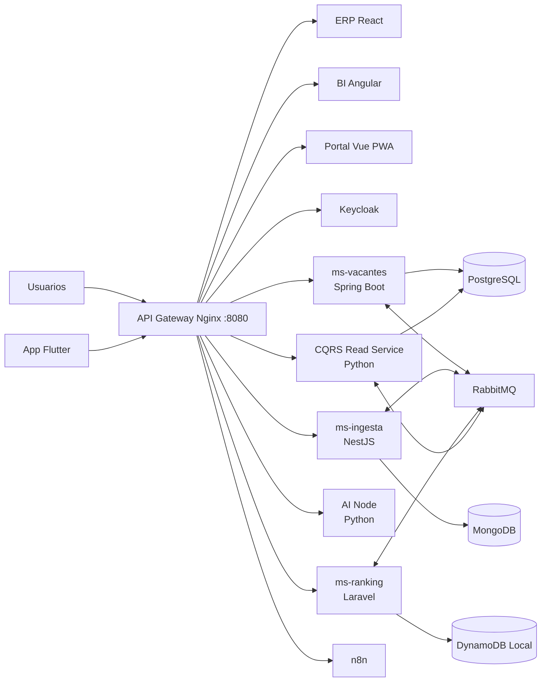

# Plataforma Empresarial de Filtrado y Ranking Automático de CVs

**Área de Recursos Humanos — UAGRM**

Plataforma empresarial distribuida para recibir currículums, evaluar compatibilidad, ordenar candidatos, administrar vacantes y automatizar procesos de selección. El sistema combina microservicios políglotas, comunicación gRPC y eventos RabbitMQ, persistencia especializada por servicio, SAGA para adjudicaciones, CQRS para reportes y experiencias web/móvil adaptadas a cada usuario.

## Capacidades principales

- Ingesta web y móvil de CVs con idempotencia y operación sin conexión.
- extracción y clasificación asistida por IA.
- ranking de candidatos por habilidades y compatibilidad.
- gestión de vacantes, cupos, preaprobaciones y contratos.
- adjudicación distribuida mediante SAGA con rollback en MongoDB y DynamoDB.
- consultas GraphQL selectivas para reducir over-fetching.
- Read Model CQRS optimizado para dashboards, voz y exportaciones XLSX/PDF.
- herramientas MCP para misiones ejecutadas por agentes de IA.
- autenticación centralizada con Keycloak y roles de RRHH.
- automatización de notificaciones y flujos con n8n.

## Arquitectura



### Backend políglota

| Componente            | Tecnología                                | Responsabilidad                                                         |
| --------------------- | ------------------------------------------ | ----------------------------------------------------------------------- |
| `ms-vacantes`       | Java 21, Spring Boot 3, JPA, GraphQL, gRPC | Vacantes, cupos, preaprobaciones, contratos y Paso 3 de la SAGA         |
| `ms-ingesta`        | Node.js, NestJS, MongoDB, gRPC             | CVs, postulaciones, idempotencia y bloqueo/compensación del expediente |
| `ms-ranking`        | PHP 8.3, Laravel, DynamoDB                 | Puntajes, rankings y coordinación de la SAGA                           |
| `ai-node`           | Python, FastAPI, gRPC, MCP                 | inferencia, scoring y orquestación de misiones de IA                   |
| `cqrs-read-service` | Python, FastAPI, SQLAlchemy                | proyección CQRS, consultas seguras, voz y exportaciones                |

### Clientes y automatización

| Aplicación           | Tecnología             | Uso                                                        |
| --------------------- | ----------------------- | ---------------------------------------------------------- |
| `mf-erp-react`      | React 18 + Vite         | operación de RRHH, candidatos y ejecución visual de SAGA |
| `mf-bi-angular`     | Angular                 | dashboards, consultas por voz y exportaciones              |
| `mf-portal-vue`     | Vue 3 + Vite + PWA      | postulación offline-first y reintentos idempotentes       |
| `app-campo-flutter` | Flutter, SQLite, TFLite | captura de candidatos y CVs en ferias sin conexión        |
| `n8n`               | n8n                     | ingesta, ranking, preaprobación y notificaciones          |

Los contratos compartidos se encuentran en [`proto/recruitment.proto`](proto/recruitment.proto). La especificación funcional y arquitectónica está disponible en [`SPEC.md`](SPEC.md).

## Contenedores y puertos

| Servicio            | Puerto host | Puerto interno | Acceso o protocolo                                  |
| ------------------- | ----------: | -------------: | --------------------------------------------------- |
| API Gateway Nginx   |    `8080` |         `80` | entrada HTTP única                                 |
| PostgreSQL          |    `5432` |       `5432` | SQL                                                 |
| MongoDB             |   `27017` |      `27017` | MongoDB                                             |
| DynamoDB Local      |    `8000` |       `8000` | API DynamoDB                                        |
| RabbitMQ            |    `5672` |       `5672` | AMQP                                                |
| RabbitMQ Management |   `15672` |      `15672` | consola web                                         |
| Keycloak            |    `8081` |       `8080` | acceso directo opcional; por gateway usa `/auth/` |
| ms-vacantes HTTP    |    `8082` |       `8080` | REST, GraphQL y MCP                                 |
| ms-vacantes gRPC    |    `9090` |       `9090` | gRPC                                                |
| ms-ingesta HTTP     |    `3000` |       `3000` | REST y MCP                                          |
| ms-ingesta gRPC     |    `9091` |       `9091` | gRPC                                                |
| ms-ranking          |    `8084` |       `8000` | REST y MCP                                          |
| AI Node HTTP        |    `8001` |       `8000` | FastAPI y agentes                                   |
| AI Node gRPC        |   `50051` |      `50051` | gRPC                                                |
| CQRS Read Service   |    `8083` |       `8080` | reportes y exportación                             |
| n8n                 |    `5678` |       `5678` | editor y webhooks                                   |
| Prometheus          |    `9092` |       `9090` | métricas y estado de targets                       |
| Grafana             |    `3001` |       `3000` | dashboards de observabilidad                       |
| Microfrontends      |          — |         `80` | publicados únicamente mediante el gateway          |

Entradas principales:

- ERP: [http://localhost:8080/erp/](http://localhost:8080/erp/)
- BI: [http://localhost:8080/bi/](http://localhost:8080/bi/)
- Portal PWA: [http://localhost:8080/portal/](http://localhost:8080/portal/)
- Keycloak: [http://localhost:8080/auth/](http://localhost:8080/auth/)
- n8n: [http://localhost:8080/automation/](http://localhost:8080/automation/)
- Healthcheck del gateway: [http://localhost:8080/health](http://localhost:8080/health)
- Prometheus: [http://localhost:9092/](http://localhost:9092/)
- Grafana: [http://localhost:3001/](http://localhost:3001/) (`admin` / `admin`)

Prometheus recoge `/actuator/prometheus` en `ms-vacantes` y `/metrics` en los demás microservicios. FastAPI y NestJS exponen métricas HTTP instrumentadas; `ms-ranking` publica `ms_ranking_up` como gauge básico de disponibilidad.

### Perfiles para desarrollo local

Usa los dos archivos Compose en todos los comandos: el principal selecciona los servicios por perfil y `docker-compose.observability.yml` aplica límites locales y ajustes de bajo consumo.

| Perfil | Servicios incluidos |
|---|---|
| `observability` | Prometheus, Grafana, los cinco servicios que exponen métricas y sus dependencias: PostgreSQL, MongoDB, DynamoDB Local, RabbitMQ y Keycloak. No inicia gateway, microfrontends ni n8n. |
| `demo` | Flujos principales completos: bases de datos, microservicios, Keycloak, gateway, microfrontends y n8n. No inicia Prometheus ni Grafana. |
| `full` | Todos los servicios, incluidos Prometheus y Grafana. |

Dependencias funcionales incluidas en esos perfiles:

| Servicio | Dependencias principales |
|---|---|
| `ms-vacantes` | PostgreSQL, RabbitMQ y Keycloak |
| `ms-ingesta` | MongoDB y RabbitMQ |
| `ms-ranking` | DynamoDB Local y RabbitMQ |
| `ai-node` | `ms-vacantes`, `ms-ingesta` y `ms-ranking` |
| `cqrs-read-service` | PostgreSQL y RabbitMQ |
| `n8n` | `ms-ingesta`, `ms-ranking` y `ai-node` |
| `api-gateway` | Keycloak, microservicios, microfrontends y n8n |
| Prometheus | Los cinco servicios de métricas: `ms-vacantes`, `ms-ingesta`, `ms-ranking`, `ai-node` y `cqrs-read-service` |
| Grafana | Prometheus |

Desde PowerShell, en la raíz del repositorio:

```powershell
$compose = @("-f", ".\infra\docker-compose.yml", "-f", ".\infra\docker-compose.observability.yml")

# Solo métricas y Grafana
docker compose @compose --profile observability up -d
docker compose @compose --profile observability ps
docker compose @compose --profile observability stop

# Flujos principales de la demostración
docker compose @compose --profile demo up -d
docker compose @compose --profile demo ps
docker compose @compose --profile demo stop

# Sistema completo
docker compose @compose --profile full up -d
docker compose @compose --profile full ps
docker compose @compose --profile full stop
```

`stop` conserva contenedores y datos. No uses `down -v`. Si faltan imágenes locales, `up` puede construir servicios que tienen `build`; autoriza esa ejecución antes de iniciarla. Para la demo de métricas, abre [http://localhost:9092/targets](http://localhost:9092/targets): los cinco targets deben aparecer como `UP`. Grafana está en [http://localhost:3001](http://localhost:3001), con `admin` / `admin`.

Los límites del perfil `full` son cotas máximas, no memoria reservada; suman aproximadamente 7,6 GiB de RAM y 6 CPU. Para esta laptop de 24 GB, empieza con 8–10 GiB y 6 procesadores asignados a Docker Desktop, dejando recursos para Windows y tus otras aplicaciones. Si el equipo vuelve a sentirse lento, usa `observability` (no incluye gateway, frontends ni n8n) o reduce los límites por servicio en `infra/docker-compose.observability.yml`. Las opciones de JVM limitan heap/procesadores de Keycloak, Spring Boot y DynamoDB Local. Prometheus conserva 36 horas de datos, comprime el WAL y consulta cada 30 segundos. Grafana desactiva plugins preinstalados y analítica/comprobaciones de actualización.

## Requisitos previos

1. **Docker Desktop** actualizado, con Docker Compose v2 habilitado.
2. **Python 3.11 o superior** disponible como `python` en PowerShell.
3. Git 2.40 o superior para control de versiones.
4. Para Docker Desktop, asigna inicialmente 8–10 GB de RAM y 6 procesadores. Si ejecutas solo `observability`, 6–8 GB suelen dejar más margen para Windows.

Compruebe las instalaciones:

```powershell
docker --version
docker compose version
python --version
git --version
```

No es necesario instalar Java, Node.js, PHP, PostgreSQL, MongoDB ni DynamoDB localmente para ejecutar el stack con Docker.

## Instalación y ejecución

### 1. Obtener el código

```powershell
git clone https://github.com/Calvimontes99/plataforma-ranking-cvs-uagrm.git
Set-Location .\plataforma-ranking-cvs-uagrm
```

### 2. Construir y levantar el stack

```powershell
$compose = @("-f", ".\infra\docker-compose.yml", "-f", ".\infra\docker-compose.observability.yml")
docker compose @compose --profile demo up -d
```

Si faltan imágenes locales, Compose puede construirlas automáticamente. Verifique los servicios del perfil:

```powershell
docker compose @compose --profile demo ps
```

### 3. Poblar el escenario de demostración

```powershell
python infra/seed-demo-data.py
```

El seed es idempotente y crea tres vacantes y ocho candidatos en PostgreSQL, MongoDB, DynamoDB Local y el Read Model CQRS. Puede repetirse para restaurar el escenario inicial.

Credenciales del realm `recruitment`:

| Usuario          | Contraseña  | Roles                  |
| ---------------- | ------------ | ---------------------- |
| `rrhh.demo`    | `Demo123!` | `RRHH`, `AI_AGENT` |
| `docente.demo` | `Demo123!` | `RRHH`               |

La guía completa para la presentación está en [`RUN_DEMO.md`](RUN_DEMO.md).

### 4. Detener el stack

```powershell
docker compose @compose --profile demo stop
```

El comando `stop` preserva los contenedores y volúmenes del proyecto.

## Desarrollo y diagnóstico

```powershell
# Estado del perfil demo
docker compose @compose --profile demo ps

# Logs principales
docker compose @compose --profile demo logs -f api-gateway ms-vacantes ms-ingesta ms-ranking ai-node cqrs-read-service

# Reconstruir un único servicio (requiere autorización para reconstruir)
docker compose @compose --profile demo up -d --build ms-vacantes
```

Los archivos `.env.example` documentan la configuración individual. Nunca deben versionarse secretos reales, tokens, certificados o archivos `.env` locales.

## Publicación inicial en GitHub

Para crear y publicar el repositorio con GitHub CLI:

```powershell
Set-Location "C:\Users\calvi\OneDrive\Desktop\parcial2-sw2"
git init
git branch -M main
git config user.name "Calvimontes99"
git config user.email "Calvimontes99@users.noreply.github.com"
git add .
git status --short
git commit -m "feat: implementar plataforma empresarial de reclutamiento"
gh auth login --web --git-protocol https
gh repo create Calvimontes99/plataforma-ranking-cvs-uagrm --public --source=. --remote=origin --push
```

Si el repositorio vacío ya fue creado desde github.com, reemplace el último comando por:

```powershell
git remote add origin https://github.com/Calvimontes99/plataforma-ranking-cvs-uagrm.git
git push -u origin main
```

Antes de `git add`, revise siempre `git status --short`. El archivo `.gitignore` raíz excluye dependencias, builds, entornos virtuales, cachés, archivos locales y secretos.

## Mejoras futuras

- sustituir clasificadores heurísticos por modelos versionados, evaluados y observables.
- agregar OpenTelemetry, métricas Prometheus, dashboards Grafana y trazas distribuidas.
- administrar secretos con GitHub Actions Secrets, Vault o el gestor del proveedor cloud.
- incorporar pruebas contractuales gRPC/eventos y pruebas end-to-end de las SAGAs.
- ejecutar análisis SAST, SCA, SBOM y escaneo de imágenes en CI.
- desplegar en Kubernetes con Helm, autoscaling y bases de datos administradas.
- incorporar migraciones versionadas del Read Model y estrategias de replay de eventos.
- mejorar accesibilidad, internacionalización y pruebas visuales de los microfrontends.
- publicar artefactos móviles firmados mediante pipelines separados para Android e iOS.

## Colaboración

1. Cree una rama desde `main`: `git switch -c feature/nombre-descriptivo`.
2. Mantenga los cambios pequeños, cohesionados y acompañados de pruebas.
3. Use commits convencionales: `feat:`, `fix:`, `docs:`, `test:`, `refactor:` o `chore:`.
4. Actualice contratos, documentación y datos demo cuando cambie una interfaz pública.
5. Abra un Pull Request explicando motivación, pruebas realizadas, riesgos y capturas cuando haya cambios visuales.
6. No confirme secretos, datos personales reales, dependencias instaladas ni artefactos compilados.

## Licencia y uso académico

Proyecto académico del Área de Recursos Humanos de la UAGRM. Antes de utilizarlo fuera del entorno educativo, defina una licencia explícita y revise las políticas aplicables de privacidad, retención de CVs y decisiones automatizadas.
