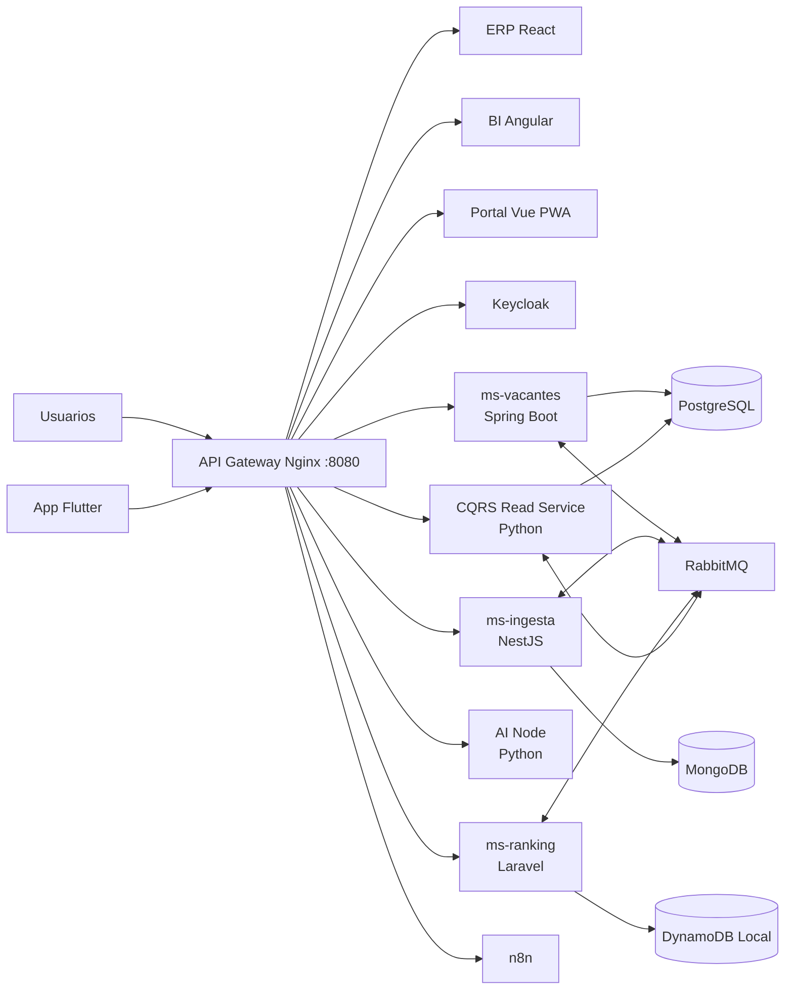

# Plataforma Empresarial de Filtrado y Ranking Automático de CVs

**Área de Recursos Humanos — UAGRM**

Plataforma empresarial distribuida para recibir currículums, evaluar compatibilidad, ordenar candidatos, administrar vacantes y automatizar procesos de selección. El sistema combina microservicios políglotas, comunicación gRPC y eventos RabbitMQ, persistencia especializada por servicio, SAGA para adjudicaciones, CQRS para reportes y experiencias web/móvil adaptadas a cada usuario.

## Capacidades principales

- Ingesta web y móvil de CVs con idempotencia y operación sin conexión.
- extracción y clasificación asistida por IA.
- ranking de candidatos por habilidades y compatibilidad.
- gestión de vacantes, cupos, preaprobaciones y contratos.
- adjudicación distribuida mediante SAGA con rollback en MongoDB y DynamoDB.
- consultas GraphQL selectivas para reducir over-fetching.
- Read Model CQRS optimizado para dashboards, voz y exportaciones XLSX/PDF.
- herramientas MCP para misiones ejecutadas por agentes de IA.
- autenticación centralizada con Keycloak y roles de RRHH.
- automatización de notificaciones y flujos con n8n.

## Arquitectura



### Backend políglota

| Componente | Tecnología | Responsabilidad |
|---|---|---|
| `ms-vacantes` | Java 21, Spring Boot 3, JPA, GraphQL, gRPC | Vacantes, cupos, preaprobaciones, contratos y Paso 3 de la SAGA |
| `ms-ingesta` | Node.js, NestJS, MongoDB, gRPC | CVs, postulaciones, idempotencia y bloqueo/compensación del expediente |
| `ms-ranking` | PHP 8.3, Laravel, DynamoDB | Puntajes, rankings y coordinación de la SAGA |
| `ai-node` | Python, FastAPI, gRPC, MCP | inferencia, scoring y orquestación de misiones de IA |
| `cqrs-read-service` | Python, FastAPI, SQLAlchemy | proyección CQRS, consultas seguras, voz y exportaciones |

### Clientes y automatización

| Aplicación | Tecnología | Uso |
|---|---|---|
| `mf-erp-react` | React 18 + Vite | operación de RRHH, candidatos y ejecución visual de SAGA |
| `mf-bi-angular` | Angular | dashboards, consultas por voz y exportaciones |
| `mf-portal-vue` | Vue 3 + Vite + PWA | postulación offline-first y reintentos idempotentes |
| `app-campo-flutter` | Flutter, SQLite, TFLite | captura de candidatos y CVs en ferias sin conexión |
| `n8n` | n8n | ingesta, ranking, preaprobación y notificaciones |

Los contratos compartidos se encuentran en [`proto/recruitment.proto`](proto/recruitment.proto). La especificación funcional y arquitectónica está disponible en [`SPEC.md`](SPEC.md).

## Contenedores y puertos

| Servicio | Puerto host | Puerto interno | Acceso o protocolo |
|---|---:|---:|---|
| API Gateway Nginx | `8080` | `80` | entrada HTTP única |
| PostgreSQL | `5432` | `5432` | SQL |
| MongoDB | `27017` | `27017` | MongoDB |
| DynamoDB Local | `8000` | `8000` | API DynamoDB |
| RabbitMQ | `5672` | `5672` | AMQP |
| RabbitMQ Management | `15672` | `15672` | consola web |
| Keycloak | `8081` | `8080` | acceso directo opcional; por gateway usa `/auth/` |
| ms-vacantes HTTP | `8082` | `8080` | REST, GraphQL y MCP |
| ms-vacantes gRPC | `9090` | `9090` | gRPC |
| ms-ingesta HTTP | `3000` | `3000` | REST y MCP |
| ms-ingesta gRPC | `9091` | `9091` | gRPC |
| ms-ranking | `8084` | `8000` | REST y MCP |
| AI Node HTTP | `8001` | `8000` | FastAPI y agentes |
| AI Node gRPC | `50051` | `50051` | gRPC |
| CQRS Read Service | `8083` | `8080` | reportes y exportación |
| n8n | `5678` | `5678` | editor y webhooks |
| Microfrontends | — | `80` | publicados únicamente mediante el gateway |

Entradas principales:

- ERP: <http://localhost:8080/erp/>
- BI: <http://localhost:8080/bi/>
- Portal PWA: <http://localhost:8080/portal/>
- Keycloak: <http://localhost:8080/auth/>
- n8n: <http://localhost:8080/automation/>
- Healthcheck del gateway: <http://localhost:8080/health>

## Requisitos previos

1. **Docker Desktop** actualizado, con Docker Compose v2 habilitado.
2. **Python 3.11 o superior** disponible como `python` en PowerShell.
3. Git 2.40 o superior para control de versiones.
4. Como referencia, se recomienda reservar al menos 8 GB de RAM para Docker Desktop.

Compruebe las instalaciones:

```powershell
docker --version
docker compose version
python --version
git --version
```

No es necesario instalar Java, Node.js, PHP, PostgreSQL, MongoDB ni DynamoDB localmente para ejecutar el stack con Docker.

## Instalación y ejecución

### 1. Obtener el código

```powershell
git clone https://github.com/Calvimontes99/plataforma-ranking-cvs-uagrm.git
Set-Location .\plataforma-ranking-cvs-uagrm
```

### 2. Construir y levantar el stack

```powershell
docker compose -f infra/docker-compose.yml up -d --build
```

La primera construcción puede tardar varios minutos. Verifique los 15 contenedores:

```powershell
docker compose -f infra/docker-compose.yml ps
```

### 3. Poblar el escenario de demostración

```powershell
python infra/seed-demo-data.py
```

El seed es idempotente y crea tres vacantes y ocho candidatos en PostgreSQL, MongoDB, DynamoDB Local y el Read Model CQRS. Puede repetirse para restaurar el escenario inicial.

Credenciales del realm `recruitment`:

| Usuario | Contraseña | Roles |
|---|---|---|
| `rrhh.demo` | `Demo123!` | `RRHH`, `AI_AGENT` |
| `docente.demo` | `Demo123!` | `RRHH` |

La guía completa para la presentación está en [`RUN_DEMO.md`](RUN_DEMO.md).

### 4. Detener el stack

```powershell
docker compose -f infra/docker-compose.yml down
```

Para eliminar también los volúmenes y reiniciar completamente los datos:

```powershell
docker compose -f infra/docker-compose.yml down -v
```

> `down -v` elimina las bases de datos locales del proyecto. No lo use si necesita conservar esos datos.

## Desarrollo y diagnóstico

```powershell
# Estado general
docker compose -f infra/docker-compose.yml ps

# Logs principales
docker compose -f infra/docker-compose.yml logs -f api-gateway ms-vacantes ms-ingesta ms-ranking ai-node cqrs-read-service

# Reconstruir un único servicio
docker compose -f infra/docker-compose.yml up -d --build ms-vacantes
```

Los archivos `.env.example` documentan la configuración individual. Nunca deben versionarse secretos reales, tokens, certificados o archivos `.env` locales.

## Publicación inicial en GitHub

Para crear y publicar el repositorio con GitHub CLI:

```powershell
Set-Location "C:\Users\calvi\OneDrive\Desktop\parcial2-sw2"
git init
git branch -M main
git config user.name "Calvimontes99"
git config user.email "Calvimontes99@users.noreply.github.com"
git add .
git status --short
git commit -m "feat: implementar plataforma empresarial de reclutamiento"
gh auth login --web --git-protocol https
gh repo create Calvimontes99/plataforma-ranking-cvs-uagrm --public --source=. --remote=origin --push
```

Si el repositorio vacío ya fue creado desde github.com, reemplace el último comando por:

```powershell
git remote add origin https://github.com/Calvimontes99/plataforma-ranking-cvs-uagrm.git
git push -u origin main
```

Antes de `git add`, revise siempre `git status --short`. El archivo `.gitignore` raíz excluye dependencias, builds, entornos virtuales, cachés, archivos locales y secretos.

## Mejoras futuras

- sustituir clasificadores heurísticos por modelos versionados, evaluados y observables.
- agregar OpenTelemetry, métricas Prometheus, dashboards Grafana y trazas distribuidas.
- administrar secretos con GitHub Actions Secrets, Vault o el gestor del proveedor cloud.
- incorporar pruebas contractuales gRPC/eventos y pruebas end-to-end de las SAGAs.
- ejecutar análisis SAST, SCA, SBOM y escaneo de imágenes en CI.
- desplegar en Kubernetes con Helm, autoscaling y bases de datos administradas.
- incorporar migraciones versionadas del Read Model y estrategias de replay de eventos.
- mejorar accesibilidad, internacionalización y pruebas visuales de los microfrontends.
- publicar artefactos móviles firmados mediante pipelines separados para Android e iOS.

## Colaboración

1. Cree una rama desde `main`: `git switch -c feature/nombre-descriptivo`.
2. Mantenga los cambios pequeños, cohesionados y acompañados de pruebas.
3. Use commits convencionales: `feat:`, `fix:`, `docs:`, `test:`, `refactor:` o `chore:`.
4. Actualice contratos, documentación y datos demo cuando cambie una interfaz pública.
5. Abra un Pull Request explicando motivación, pruebas realizadas, riesgos y capturas cuando haya cambios visuales.
6. No confirme secretos, datos personales reales, dependencias instaladas ni artefactos compilados.

## Licencia y uso académico

Proyecto académico del Área de Recursos Humanos de la UAGRM. Antes de utilizarlo fuera del entorno educativo, defina una licencia explícita y revise las políticas aplicables de privacidad, retención de CVs y decisiones automatizadas.
