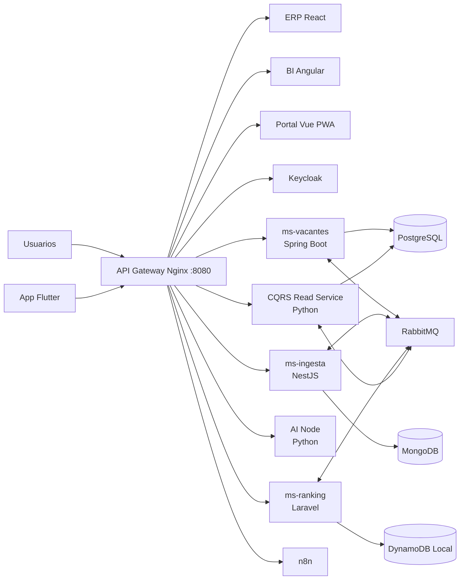
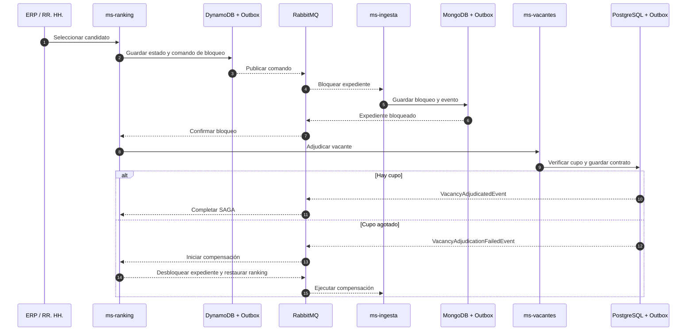
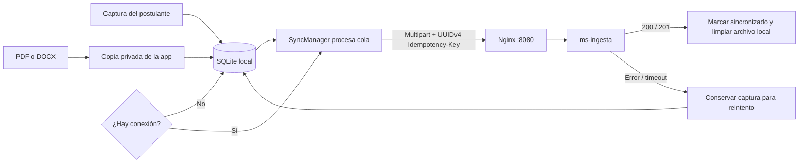

# Plataforma Empresarial de Filtrado y Ranking Automático de CVs

**Área de Recursos Humanos — UAGRM**

Plataforma empresarial distribuida para recibir currículums, evaluar compatibilidad, ordenar candidatos, administrar vacantes y automatizar procesos de selección. El sistema combina microservicios políglotas, comunicación gRPC y eventos RabbitMQ, persistencia especializada por servicio, SAGA para adjudicaciones, CQRS para reportes y experiencias web/móvil adaptadas a cada usuario.

## Capacidades principales

- Ingesta web y móvil de CVs con idempotencia y operación sin conexión.
- extracción y clasificación asistida por IA.
- ranking de candidatos por habilidades y compatibilidad.
- gestión de vacantes, cupos, preaprobaciones y contratos.
- adjudicación distribuida mediante SAGA con eventos de compensación entre los servicios participantes.
- consultas GraphQL selectivas para reducir over-fetching.
- Read Model CQRS optimizado para dashboards, voz y exportaciones XLSX/PDF.
- herramientas MCP para misiones ejecutadas por agentes de IA.
- autenticación centralizada con Keycloak y roles de RRHH.
- automatización de notificaciones y flujos con n8n.

## Arquitectura



### Backend políglota

| Componente            | Tecnología                                | Responsabilidad                                                         |
| --------------------- | ------------------------------------------ | ----------------------------------------------------------------------- |
| `ms-vacantes`       | Java 21, Spring Boot 3, JPA, GraphQL, gRPC | Vacantes, cupos, preaprobaciones, contratos y Paso 3 de la SAGA         |
| `ms-ingesta`        | Node.js, NestJS, MongoDB, gRPC             | CVs, postulaciones, idempotencia y bloqueo/compensación del expediente |
| `ms-ranking`        | PHP 8.3, Laravel, DynamoDB                 | Puntajes, rankings y coordinación de la SAGA                           |
| `ai-node`           | Python, FastAPI, gRPC, MCP                 | inferencia, scoring y orquestación de misiones de IA                   |
| `cqrs-read-service` | Python, FastAPI, SQLAlchemy                | proyección CQRS, consultas seguras, voz y exportaciones                |

### Clientes y automatización

| Aplicación           | Tecnología             | Uso                                                        |
| --------------------- | ----------------------- | ---------------------------------------------------------- |
| `mf-erp-react`      | React 18 + Vite         | operación de RRHH, candidatos y ejecución visual de SAGA |
| `mf-bi-angular`     | Angular                 | dashboards, consultas por voz y exportaciones              |
| `mf-portal-vue`     | Vue 3 + Vite + PWA      | postulación offline-first y reintentos idempotentes       |
| `app-campo-flutter` | Flutter, SQLite, TFLite | captura de candidatos y CVs en ferias sin conexión        |
| `n8n`               | n8n                     | ingesta, ranking, preaprobación y notificaciones          |

Los contratos compartidos se encuentran en [`proto/recruitment.proto`](proto/recruitment.proto). La especificación funcional y arquitectónica está disponible en [`SPEC.md`](SPEC.md).

## Flujos técnicos implementados

Esta sección describe el comportamiento que se encuentra en el código del repositorio. Los servicios requieren configuración local (variables de entorno, credenciales externas y activación de workflows) para operar fuera del entorno de demostración.

### Entrada, servicios y persistencia

Nginx es la entrada HTTP del stack y se publica en el puerto `8080`. Enruta las interfaces web bajo `/erp/`, `/bi/` y `/portal/`; Keycloak bajo `/auth/`; n8n bajo `/automation/`; y las API versionadas de vacantes, ingesta, ranking, IA y lectura bajo `/api/v1/`. También expone `/health`. Los servicios publican contratos HTTP y, donde está configurado, gRPC; los eventos de dominio circulan por RabbitMQ.

ERP y Portal requieren una sesión OIDC del realm `recruitment` a través del gateway (`http://localhost:8080/auth/`). Los roles `ADMIN` y `RRHH` dan acceso de gestión al ERP; `AI_AGENT` entra al espacio de agentes; `CANDIDATE` accede al Portal. El auto-registro del realm está habilitado y asigna `CANDIDATE` como rol predeterminado. BI se mantiene disponible bajo `/bi/`.

| Servicio | Responsabilidad | Persistencia principal |
| --- | --- | --- |
| `ms-vacantes` (Spring Boot) | Vacantes, disponibilidad de cupos, preaprobaciones, contratos y participante final de adjudicación. Expone REST, GraphQL y gRPC. | PostgreSQL |
| `ms-ingesta` (NestJS) | Recepción de postulaciones y CV por JSON o multipart, idempotencia, expediente y comandos/eventos de la SAGA. | MongoDB |
| `ms-ranking` (Laravel) | Evaluación/ranking, estado coordinador de la SAGA, auditoría y eventos de salida. | DynamoDB (DynamoDB Local en desarrollo) |
| `ai-node` (FastAPI) | Extracción y análisis asistido, embeddings, compatibilidad, agrupación y ejecución de misiones de agentes. | Servicio de inferencia; consulta a otros servicios según el flujo |
| `cqrs-read-service` (FastAPI) | Proyección de lectura consumida desde RabbitMQ, consultas de reportes y exportaciones PDF/XLSX. | PostgreSQL, con credenciales de solo lectura para reportes |

Las aplicaciones cliente son `mf-erp-react` (operaciones de RR. HH.), `mf-bi-angular` (indicadores y reportes), `mf-portal-vue` (portal de postulantes) y `app-campo-flutter` (captura móvil). El gateway y las rutas concretas están definidos en [`infra/nginx/nginx.conf`](infra/nginx/nginx.conf); el despliegue local y sus dependencias, en [`infra/docker-compose.yml`](infra/docker-compose.yml).

### Adjudicación distribuida: SAGA y compensación

El flujo coordinado por `ms-ranking` es una transacción distribuida basada en eventos y Outbox; no es una transacción ACID compartida entre las tres bases de datos. En términos funcionales:

1. `ms-ranking` selecciona al candidato para la SAGA y persiste el nuevo estado, auditoría y comando de bloqueo en el Outbox de DynamoDB.
2. El comando llega a `ms-ingesta` por RabbitMQ. El servicio bloquea el expediente y registra el resultado mediante su Outbox en MongoDB.
3. Con el expediente bloqueado, `ms-ranking` invoca el paso de adjudicación de `ms-vacantes`. En una transacción PostgreSQL, el servicio verifica el cupo, registra el contrato y agrega el evento de resultado al Outbox.
4. Al agotarse los cupos, `ms-vacantes` registra `VacancyAdjudicationFailedEvent` en el Outbox y lanza `CupoAgotadoException`. La excepción no revierte la transacción que guarda el evento de fallo (`noRollbackFor`), para que el publicador pueda notificar al coordinador.
5. Ante el fallo, `ms-ranking` marca la SAGA en compensación, emite el comando de desbloqueo/restauración a `ms-ingesta` y revierte la selección del ranking. Los eventos de éxito llevan la SAGA a completada.

Los publicadores de Outbox entregan estos mensajes a RabbitMQ de forma asíncrona. Esto evita mantener una transacción de base de datos abierta durante llamadas de red; la convergencia y la compensación se realizan por eventos. Las implementaciones están en `services/ms-ranking/app/UseCases`, `services/ms-ingesta/src/application/use-cases` y `services/ms-vacantes/src/main/java/com/recruitment/vacancies/application/usecase`.



### App Flutter: captura y sincronización offline-first

La app móvil mantiene una cola local en SQLite (`captures`). Cada postulación tiene un UUIDv4 persistido como clave de idempotencia, para reutilizarlo en los reintentos. La base de datos está versionada; el esquema actual almacena además ruta, nombre y tipo MIME del adjunto.

El usuario puede elegir un PDF o DOCX con `file_picker`. Antes de guardar la postulación, la app copia el archivo seleccionado al directorio privado de la aplicación; la ruta de esa copia queda guardada en SQLite, de modo que el archivo siga disponible aunque el proveedor de archivos retire su copia temporal. Al sincronizar, el `SyncManager` procesa la cola por lotes (hasta 50 elementos por llamada) y envía las capturas con documento como `multipart/form-data` a `POST /api/v1/ingestion/cvs/upload`. Incluye el archivo en `file`, los campos de postulación y las cabeceras `Idempotency-Key` y `X-Idempotency-Key` con el mismo UUIDv4. Las capturas sin adjunto usan `POST /api/v1/ingestion/cvs` con JSON.

La pantalla intenta sincronizar al detectar conexión y permite sincronización manual. Un registro y su copia local solo se eliminan cuando el servidor responde HTTP `200` o `201`; errores HTTP o de red conservan la cola para reintentar. `ms-ingesta` valida el tipo de archivo (PDF, DOCX o imágenes permitidas) y limita la carga a 10 MiB. La URL del gateway se configura con `GATEWAY_URL`; en un teléfono físico, el equipo debe poder alcanzar la dirección IP del host o se puede usar `adb reverse` durante desarrollo. Véase [`apps/app-campo-flutter/README.md`](apps/app-campo-flutter/README.md).



### Notificaciones push: Firebase Cloud Messaging

`app-campo-flutter` inicializa Firebase al arrancar, registra un handler de fondo y solicita permisos de notificación en Android (incluido el permiso en tiempo de ejecución de Android 13 y posteriores). `PushNotificationService` obtiene el token de la instalación, maneja su renovación, muestra mensajes en primer plano mediante `flutter_local_notifications` y procesa la apertura desde notificaciones. En segundo plano, Android presenta los mensajes FCM con payload `notification`; los mensajes solo de datos se muestran mediante notificación local en el handler.

Para probar en un Honor, la app debe tener la configuración Firebase correspondiente al `applicationId` Android, el usuario debe conceder el permiso y el dispositivo debe tener Google Play Services disponibles para FCM. En Android 13+, el permiso de notificaciones debe quedar habilitado. En MagicOS, también conviene permitir inicio/actividad en segundo plano y excluir la app de restricciones agresivas de batería si las alertas se retrasan cuando el teléfono está bloqueado; los nombres de estos controles dependen de la versión del sistema. El token identifica una instalación y debe asociarse de forma autenticada a la cuenta reclutadora en el backend. **En el estado actual, la app obtiene y muestra/expone el token, pero no existe aún un endpoint del monorepo que lo registre automáticamente ni un flujo de producción que envíe notificaciones de sincronización o vacantes prioritarias.** `fcm-test` es una utilidad de envío manual con Firebase Admin SDK (FCM HTTP v1); requiere credenciales de servicio y un token de dispositivo locales. Nunca se deben guardar esas credenciales en Git.

### Ingesta omnicanal con n8n

El workflow [`infra/n8n/workflow-reclutamiento-whatsapp.json`](infra/n8n/workflow-reclutamiento-whatsapp.json) define un webhook `POST /automation/webhook/whatsapp-cv`. Recibe datos de postulante y CV, envía la postulación a `ms-ingesta`, solicita evaluación a `ms-ranking`, aplica una condición de puntuación (`score >= 85`) y, si cumple el umbral, solicita la preaprobación en `ms-vacantes` y envía invitaciones por SMTP y WhatsApp. La ingesta lleva una clave idempotente basada en el identificador del mensaje cuando está disponible.

El archivo es una plantilla importable, pero actualmente figura con `active: false` y credenciales SMTP incompletas. Para ejecutar el flujo se debe importar y activar en n8n, configurar `N8N_SERVICE_TOKEN`, `WHATSAPP_TOKEN`, la URL del proveedor y las credenciales SMTP. Por ello, la descripción del flujo representa la automatización definida en el repositorio; el webhook no queda operativo solo por levantar Docker Compose.

### Límites actuales de la integración

- El flujo FCM y el workflow de n8n están implementados por separado: n8n aún no envía alertas push a reclutadores.
- La utilidad `firebase-admin` sirve para pruebas manuales; no sustituye una integración de notificaciones en backend ni el registro autenticado de tokens.
- La disponibilidad real de cada flujo depende de los servicios externos y credenciales configurados en el entorno.

## Contenedores y puertos

| Servicio            | Puerto host | Puerto interno | Acceso o protocolo                                  |
| ------------------- | ----------: | -------------: | --------------------------------------------------- |
| API Gateway Nginx   |    `8080` |         `80` | entrada HTTP única                                 |
| PostgreSQL          |    `5432` |       `5432` | SQL                                                 |
| MongoDB             |   `27017` |      `27017` | MongoDB                                             |
| DynamoDB Local      |    `8000` |       `8000` | API DynamoDB                                        |
| RabbitMQ            |    `5672` |       `5672` | AMQP                                                |
| RabbitMQ Management |   `15672` |      `15672` | consola web                                         |
| Keycloak            |    `8081` |       `8080` | acceso directo opcional; por gateway usa `/auth/` |
| ms-vacantes HTTP    |    `8082` |       `8080` | REST, GraphQL y MCP                                 |
| ms-vacantes gRPC    |    `9090` |       `9090` | gRPC                                                |
| ms-ingesta HTTP     |    `3000` |       `3000` | REST y MCP                                          |
| ms-ingesta gRPC     |    `9091` |       `9091` | gRPC                                                |
| ms-ranking          |    `8084` |       `8000` | REST y MCP                                          |
| AI Node HTTP        |    `8001` |       `8000` | FastAPI y agentes                                   |
| AI Node gRPC        |   `50051` |      `50051` | gRPC                                                |
| CQRS Read Service   |    `8083` |       `8080` | reportes y exportación                             |
| n8n                 |    `5678` |       `5678` | editor y webhooks                                   |
| Prometheus          |    `9092` |       `9090` | métricas y estado de targets                       |
| Grafana             |    `3001` |       `3000` | dashboards de observabilidad                       |
| Microfrontends      |          — |         `80` | publicados únicamente mediante el gateway          |

Entradas principales:

- ERP: [http://localhost:8080/erp/](http://localhost:8080/erp/)
- BI: [http://localhost:8080/bi/](http://localhost:8080/bi/)
- Portal PWA: [http://localhost:8080/portal/](http://localhost:8080/portal/)
- Keycloak: [http://localhost:8080/auth/](http://localhost:8080/auth/)
- n8n: [http://localhost:8080/automation/](http://localhost:8080/automation/)
- Healthcheck del gateway: [http://localhost:8080/health](http://localhost:8080/health)
- Prometheus: [http://localhost:9092/](http://localhost:9092/)
- Grafana: [http://localhost:3001/](http://localhost:3001/) (`admin` / `admin`)

Prometheus recoge `/actuator/prometheus` en `ms-vacantes` y `/metrics` en los demás microservicios. FastAPI y NestJS exponen métricas HTTP instrumentadas; `ms-ranking` publica `ms_ranking_up` como gauge básico de disponibilidad.

### Perfiles para desarrollo local

Usa los dos archivos Compose en todos los comandos: el principal selecciona los servicios por perfil y `docker-compose.observability.yml` aplica límites locales y ajustes de bajo consumo.

| Perfil | Servicios incluidos |
|---|---|
| `observability` | Prometheus, Grafana, los cinco servicios que exponen métricas y sus dependencias: PostgreSQL, MongoDB, DynamoDB Local, RabbitMQ y Keycloak. No inicia gateway, microfrontends ni n8n. |
| `demo` | Flujos principales completos: bases de datos, microservicios, Keycloak, gateway, microfrontends y n8n. No inicia Prometheus ni Grafana. |
| `full` | Todos los servicios, incluidos Prometheus y Grafana. |

Dependencias funcionales incluidas en esos perfiles:

| Servicio | Dependencias principales |
|---|---|
| `ms-vacantes` | PostgreSQL, RabbitMQ y Keycloak |
| `ms-ingesta` | MongoDB y RabbitMQ |
| `ms-ranking` | DynamoDB Local y RabbitMQ |
| `ai-node` | `ms-vacantes`, `ms-ingesta` y `ms-ranking` |
| `cqrs-read-service` | PostgreSQL y RabbitMQ |
| `n8n` | `ms-ingesta`, `ms-ranking` y `ai-node` |
| `api-gateway` | Keycloak, microservicios, microfrontends y n8n |
| Prometheus | Los cinco servicios de métricas: `ms-vacantes`, `ms-ingesta`, `ms-ranking`, `ai-node` y `cqrs-read-service` |
| Grafana | Prometheus |

Desde PowerShell, en la raíz del repositorio:

```powershell
$compose = @("-f", ".\infra\docker-compose.yml", "-f", ".\infra\docker-compose.observability.yml")

# Solo métricas y Grafana
docker compose @compose --profile observability up -d
docker compose @compose --profile observability ps
docker compose @compose --profile observability stop

# Flujos principales de la demostración
docker compose @compose --profile demo up -d
docker compose @compose --profile demo ps
docker compose @compose --profile demo stop

# Sistema completo
docker compose @compose --profile full up -d
docker compose @compose --profile full ps
docker compose @compose --profile full stop
```

`stop` conserva contenedores y datos. No uses `down -v`. Si faltan imágenes locales, `up` puede construir servicios que tienen `build`; autoriza esa ejecución antes de iniciarla. Para la demo de métricas, abre [http://localhost:9092/targets](http://localhost:9092/targets): los cinco targets deben aparecer como `UP`. Grafana está en [http://localhost:3001](http://localhost:3001), con `admin` / `admin`.

Los límites del perfil `full` son cotas máximas, no memoria reservada; suman aproximadamente 7,6 GiB de RAM y 6 CPU. Para esta laptop de 24 GB, empieza con 8–10 GiB y 6 procesadores asignados a Docker Desktop, dejando recursos para Windows y tus otras aplicaciones. Si el equipo vuelve a sentirse lento, usa `observability` (no incluye gateway, frontends ni n8n) o reduce los límites por servicio en `infra/docker-compose.observability.yml`. Las opciones de JVM limitan heap/procesadores de Keycloak, Spring Boot y DynamoDB Local. Prometheus conserva 36 horas de datos, comprime el WAL y consulta cada 30 segundos. Grafana desactiva plugins preinstalados y analítica/comprobaciones de actualización.

## Requisitos previos

1. **Docker Desktop** actualizado, con Docker Compose v2 habilitado.
2. **Python 3.11 o superior** disponible como `python` en PowerShell.
3. Git 2.40 o superior para control de versiones.
4. Para Docker Desktop, asigna inicialmente 8–10 GB de RAM y 6 procesadores. Si ejecutas solo `observability`, 6–8 GB suelen dejar más margen para Windows.

Compruebe las instalaciones:

```powershell
docker --version
docker compose version
python --version
git --version
```

No es necesario instalar Java, Node.js, PHP, PostgreSQL, MongoDB ni DynamoDB localmente para ejecutar el stack con Docker.

## Instalación y ejecución

### 1. Obtener el código

```powershell
git clone https://github.com/Calvimontes99/plataforma-ranking-cvs-uagrm.git
Set-Location .\plataforma-ranking-cvs-uagrm
```

### 2. Construir y levantar el stack

```powershell
$compose = @("-f", ".\infra\docker-compose.yml", "-f", ".\infra\docker-compose.observability.yml")
docker compose @compose --profile demo up -d
```

Si faltan imágenes locales, Compose puede construirlas automáticamente. Verifique los servicios del perfil:

```powershell
docker compose @compose --profile demo ps
```

### 3. Poblar el escenario de demostración

```powershell
python infra/seed-demo-data.py
```

El seed es idempotente y crea tres vacantes y ocho candidatos en PostgreSQL, MongoDB, DynamoDB Local y el Read Model CQRS. Puede repetirse para restaurar el escenario de demostración; son datos sintéticos, no una copia de las bases activas.

Para agregar un lote mayor sin borrar ni reiniciar datos existentes, levanta el perfil `demo` y ejecuta:

```powershell
python infra/seed-bulk-candidates.py
```

El seeder agrega 72 perfiles ficticios deterministas (80 en total junto con los ocho base), con 18 postulaciones por estado: evaluadas, preaprobadas, seleccionadas y rechazadas. Usa IDs relacionados para candidato, CV, postulación, vacante y ranking en MongoDB, PostgreSQL, DynamoDB Local y el Read Model; es idempotente y requiere que existan las tres vacantes del escenario base. Los datos sintéticos incluyen perfiles/educación/habilidades variados, canales y marcas temporales. Las preaprobaciones se registran en PostgreSQL para que aparezcan en el ERP; el Read Model se siembra directamente para que los reportes BI tengan filas disponibles. No se generan archivos CV reales.

### Respaldo y restauración de datos

Con el perfil `demo` en ejecución, exporta PostgreSQL (vacantes y Read Model CQRS), MongoDB (ingesta) y las cinco tablas DynamoDB Local desde la raíz del repositorio:

```powershell
.\infra\backup-db.ps1
```

Los archivos quedan en `infra/postgres/backups/` (`vacancies.dump`, `read-model.dump`), `infra/mongodb/backups/` (`ingestion.archive.gz`) y `infra/dynamodb/backups/` (`dynamodb.json`). El script utiliza `pg_dump`, `mongodump` y el SDK de DynamoDB que ya está instalado en `ms-ranking`. Los respaldos se excluyen de Git porque pueden incluir datos personales; transfiérelos al compañero por un canal privado. Después de clonar, desde la raíz del repositorio, debe copiarlos a sus rutas:

```powershell
$backupDir = "C:\ruta\privada\al\respaldo"
Copy-Item "$backupDir\vacancies.dump" .\infra\postgres\backups\
Copy-Item "$backupDir\read-model.dump" .\infra\postgres\backups\
Copy-Item "$backupDir\ingestion.archive.gz" .\infra\mongodb\backups\
Copy-Item "$backupDir\dynamodb.json" .\infra\dynamodb\backups\
```

En una instalación nueva, inicia el perfil `demo`:

```powershell
$compose = @("-f", ".\infra\docker-compose.yml", "--profile", "demo")
docker compose @compose up -d
```

Si `postgres_data` está vacío, los scripts de inicialización crean las bases y restauran automáticamente `vacancies.dump` y `read-model.dump` cuando esos archivos existen. La restauración de PostgreSQL se ejecuta solo durante la primera inicialización del volumen. Cuando los servicios estén saludables, ejecuta el restaurador:

```powershell
.\infra\restore-db.ps1
```

Este comando restaura MongoDB y DynamoDB Local; las tablas DynamoDB se crean al iniciar `ms-ranking`. Ejecútalo una vez sobre volúmenes nuevos para reproducir el snapshot sin combinarlo con datos previos. Los volcados no incluyen la base interna de Keycloak (el realm se importa desde `infra/keycloak/realm-recruitment.json`) ni el SQLite privado que reside en cada instalación móvil. Para recrear el conjunto sintético de demostración en los almacenes, ejecuta `python infra/seed-demo-data.py` después de que el stack esté saludable.

Credenciales del realm `recruitment`:

| Usuario          | Contraseña  | Roles                  |
| ---------------- | ------------ | ---------------------- |
| `rrhh.demo`    | `Demo123!` | `ADMIN`, `RRHH` |
| `docente.demo` | `Demo123!` | `AI_AGENT` |

Las cuentas nuevas se registran desde el formulario de Keycloak y reciben el rol `CANDIDATE`; no obtienen acceso al ERP.

La guía completa para la presentación está en [`RUN_DEMO.md`](RUN_DEMO.md).

### 4. Detener el stack

```powershell
docker compose @compose --profile demo stop
```

El comando `stop` preserva los contenedores y volúmenes del proyecto.

## Desarrollo y diagnóstico

```powershell
# Estado del perfil demo
docker compose @compose --profile demo ps

# Logs principales
docker compose @compose --profile demo logs -f api-gateway ms-vacantes ms-ingesta ms-ranking ai-node cqrs-read-service

# Reconstruir un único servicio (requiere autorización para reconstruir)
docker compose @compose --profile demo up -d --build ms-vacantes
```

Los archivos `.env.example` documentan la configuración individual. Nunca deben versionarse secretos reales, tokens, certificados o archivos `.env` locales.

## Publicación inicial en GitHub

Para crear y publicar el repositorio con GitHub CLI:

```powershell
Set-Location "C:\Users\calvi\OneDrive\Desktop\parcial2-sw2"
git init
git branch -M main
git config user.name "Calvimontes99"
git config user.email "Calvimontes99@users.noreply.github.com"
git add .
git status --short
git commit -m "feat: implementar plataforma empresarial de reclutamiento"
gh auth login --web --git-protocol https
gh repo create Calvimontes99/plataforma-ranking-cvs-uagrm --public --source=. --remote=origin --push
```

Si el repositorio vacío ya fue creado desde github.com, reemplace el último comando por:

```powershell
git remote add origin https://github.com/Calvimontes99/plataforma-ranking-cvs-uagrm.git
git push -u origin main
```

Antes de `git add`, revise siempre `git status --short`. El archivo `.gitignore` raíz excluye dependencias, builds, entornos virtuales, cachés, archivos locales y secretos.

## Mejoras futuras

- sustituir clasificadores heurísticos por modelos versionados, evaluados y observables.
- agregar OpenTelemetry, métricas Prometheus, dashboards Grafana y trazas distribuidas.
- administrar secretos con GitHub Actions Secrets, Vault o el gestor del proveedor cloud.
- incorporar pruebas contractuales gRPC/eventos y pruebas end-to-end de las SAGAs.
- ejecutar análisis SAST, SCA, SBOM y escaneo de imágenes en CI.
- desplegar en Kubernetes con Helm, autoscaling y bases de datos administradas.
- incorporar migraciones versionadas del Read Model y estrategias de replay de eventos.
- mejorar accesibilidad, internacionalización y pruebas visuales de los microfrontends.
- publicar artefactos móviles firmados mediante pipelines separados para Android e iOS.

## Colaboración

1. Cree una rama desde `main`: `git switch -c feature/nombre-descriptivo`.
2. Mantenga los cambios pequeños, cohesionados y acompañados de pruebas.
3. Use commits convencionales: `feat:`, `fix:`, `docs:`, `test:`, `refactor:` o `chore:`.
4. Actualice contratos, documentación y datos demo cuando cambie una interfaz pública.
5. Abra un Pull Request explicando motivación, pruebas realizadas, riesgos y capturas cuando haya cambios visuales.
6. No confirme secretos, datos personales reales, dependencias instaladas ni artefactos compilados.

## Licencia y uso académico

Proyecto académico del Área de Recursos Humanos de la UAGRM. Antes de utilizarlo fuera del entorno educativo, defina una licencia explícita y revise las políticas aplicables de privacidad, retención de CVs y decisiones automatizadas.
